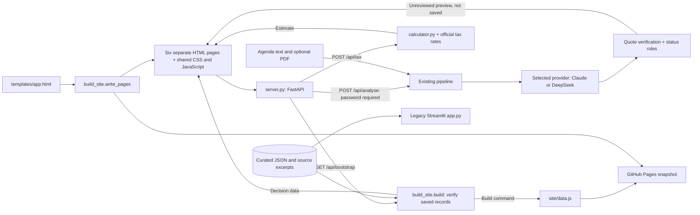

# CivicClear — City Decisions, Decoded

**CIVIC Hack 2026 prototype · City of Toronto · Source-linked decision explainers**

**Existing published snapshot: https://zxding2007.github.io/civicclear-2026/** — opens in any browser, no sign-in. GitHub Actions publishes `site/` after a successful build on `main`. The latest local application and documentation changes are being prepared for review and have not yet been pushed or deployed.

CivicClear gives residents a plain-language summary of **what was proposed**, **which decision-making body actually acted**, **which wards appear in the record**, **what is and is not known about participation**, and **the text supporting each claim**.

> **Project state (Nov 13, 2026):** The preferred local application serves the website and a FastAPI backend together through `server.py`. GitHub Pages remains a static snapshot of four curated Toronto agenda items and never calls an AI model. The four cards were drafted with ChatGPT from official agenda excerpts and pass the automated quote and status checks; the team's human sign-off is **still pending** and each card says so. The repository also retains the earlier Streamlit version (https://civicclear-2026.onrender.com/, Render Free Plan, slow to wake). The connected app includes an optional, password-gated Claude or DeepSeek analyser for new items. Its API integration has only been exercised with fake clients: **no real API call has been made**. The new Python server has not been deployed to the existing Render service as part of this change.

## Why this exists

A statement like “received for information” may sound like approval to a resident. Conversely, a committee's amended decision may not be final Council approval. CivicClear uses a **three-stage decision timeline** instead of collapsing all official language into a yes/no verdict.

**Primary users:** Toronto residents; potential institutional users include council offices, clerks, public engagement and communications teams.

## Features

- **Council Decoder:** Staff recommendation → committee action → City Council decision, with verbatim evidence.
- **Ward filter:** Match an agenda item's listed ward(s) to a user-selected ward; citywide items apply to all.
- **Claim-level source panels and stakeholder impacts:** Two core planning cases distinguish official priorities from possible consequences and questions for residents, businesses and community organizations. No quantified effects are inferred.
- **Have Your Say:** Never infer a comment deadline from a meeting date. For PH29.2, a *separate current City consultation portal* confirms an interactive feedback map through **November 30, 2026**; the app auto-stops advertising it as open afterward. Other items do not claim unverified open windows.
- **Before & After:** A residential **municipal** property tax estimate comparing 2025 and 2026 at a *constant* MPAC assessed value. Education tax is excluded.
- **Evidence and uncertainty:** Expand the original quote and source link for every example explanation, and see important unknowns.
- **Optional admin analysis (connected app and legacy Streamlit, untested live):** With a DeepSeek or Anthropic key and admin password, paste official Toronto agenda text and an optional staff-report PDF for two separate AI passes: structured extraction and a source-linked explanation. DeepSeek receives locally extracted PDF text; Claude retains its document-citation flow. The connected app returns an unreviewed preview without saving or publishing it.

### Four example items

| Toronto agenda item | Official stage | What it illustrates |
| --- | --- | --- |
| [2026.DM41.4](https://secure.toronto.ca/council/agenda-item.do?item=2026.DM41.4) | Council received for information | A motion **was not approved** merely by being received |
| [2026.PH29.2](https://secure.toronto.ca/council/agenda-item.do?item=2026.PH29.2) | Committee adopted with amendments | Official [project feedback map](https://haveyoursay.toronto.ca/LJOV-Planning-Framework-CHRA) is advertised open through Nov. 30, 2026; still no final Council framework adoption |
| [2026.PH29.1](https://secure.toronto.ca/council/agenda-item.do?item=2026.PH29.1) | Council adopted without amendments | Separate staff, committee and Council stages |
| [2026.CC38.1](https://secure.toronto.ca/council/agenda-item.do?item=2026.CC38.1) | Council adopted with amendments | Source-based municipal tax calculation |

The example `item_page.txt` files intentionally contain **selected, non-personal excerpts**, not full scraped pages. The source links lead to the entire official record. A complete source excerpt and any uploaded staff report should be manually inspected by the team before publishing any automatically generated card.

The calculator's rates are linked to enacted Toronto levy bylaws: **0.601087% for 2025** in [By-law 105-2025](https://www.toronto.ca/legdocs/bylaws/2025/law0105.pdf#page=6), and **0.614311% for 2026** in [By-law 133-2026](https://www.toronto.ca/legdocs/bylaws/2026/law0133.pdf#page=6). Both appear on page 6, Column 5 and include the City Building Fund. `data/tax_rates.json` retains the original agenda sources alongside these direct bylaw links.

## Run locally

Use Python 3.12 explicitly when creating the environment:

```bash
# macOS/Linux:
python3.12 -m venv .venv
source .venv/bin/activate
# Windows PowerShell:
# py -3.12 -m venv .venv
# .venv\Scripts\Activate.ps1
python -m pip install -r requirements.txt
python build_site.py
python -m uvicorn server:app --reload
```

Open **http://localhost:8000**. The website has six separate HTML pages, connected by ordinary links that load a new document. The server supplies those pages, verified decision data and tax calculations from the same address. The four preloaded items and tax calculator work **without any API key**.

Optional, local admin analysis:

```bash
cp .env.example .env
# Fill in the .env values with your own secrets; never commit .env
python -m uvicorn server:app --reload
```

`server.py` reads `.env` automatically. Choose one provider and fill its key plus a strong analyst password in your private `.env` or host environment. The blank values below intentionally leave analysis disabled until filled.

For DeepSeek:

```dotenv
CIVICCLEAR_PROVIDER=deepseek
DEEPSEEK_API_KEY=
CIVICCLEAR_ANALYST_PASSWORD=
```

For Claude:

```dotenv
CIVICCLEAR_PROVIDER=anthropic
ANTHROPIC_API_KEY=
CIVICCLEAR_ANALYST_PASSWORD=
```

`CIVICCLEAR_MODEL` is optional. The defaults are `deepseek-flash` for DeepSeek and the existing `claude-opus-5-5` for Anthropic; verify access in your provider account. **Remove or replace an old model override when switching provider.** If `CIVICCLEAR_PROVIDER` is unset, DeepSeek is selected only when `DEEPSEEK_API_KEY` is present and `ANTHROPIC_API_KEY` is absent; otherwise Anthropic is selected. An explicit provider is clearer when both keys exist. Existing environment variables take precedence over `.env`.

DeepSeek uses two JSON responses: a Pydantic-validated decision card and an explanation with model-provided quotation references checked against the supplied sources. This is not Anthropic's native citation feature. Its PDF path extracts text locally and rejects PDFs without readable text; scanned documents need readable text supplied separately. Claude retains its existing structured-output and native document-citation requests. Keys stay on the Python server. No external AI call occurs until an administrator submits analysis, or an operator explicitly runs the cache-generation command. Neither provider has been tested with a real paid request in this work. See the [DeepSeek API](https://api-docs.deepseek.com/) and [JSON output](https://api-docs.deepseek.com/guides/json_mode/) documentation.

The earlier Streamlit interface remains available separately:

```bash
streamlit run app.py
```

For Streamlit, export the environment variables in your shell or use `.streamlit/secrets.toml` locally. Streamlit Community Cloud secrets are entered in the app's Settings / Secrets dialog; **do not commit secrets**. The Streamlit entrypoint does not serve the new website or `/api/` routes.

To generate a cache for a new item by CLI: prepare `data/items/<ID>/item_page.txt`, `meta.json`, and optionally `report.pdf`; run `python build_cache.py --item <ID>` with the selected provider and its API key configured. The CLI loads `.env`; it does not use the web analyst password. `--force` is required to replace existing curated cards, and generated output is labelled **AI unreviewed**.

## Website structure and rebuild

| Page in `site/` | Purpose |
| --- | --- |
| `index.html` | Overview |
| `decisions.html` | Search and filter the decision list |
| `decision.html?id=2026.PH29.2` | Details and evidence for one agenda item |
| `calculator.html` | Municipal tax comparison |
| `sources.html` | Sources and method |
| `analyse.html` | Optional authorized analysis of a new record |

`templates/app.html` is the shared HTML source for navigation and the page shell. `build_site.write_pages(directory)` generates all six HTML documents from it. Each document loads the shared `site/app.js` and `site/page.css`; JavaScript handles that page's data and interactions. Page navigation uses normal `href` links, with the selected decision in the query string, and has no hash router.

After editing the template or saved records, run:

```bash
python build_site.py
```

The build verifies the records, writes `site/data.js`, then generates the six pages. Edit `templates/app.html` for shared HTML changes rather than editing its generated copies. The backend remains `server.py`, with `pipeline/` handling source interpretation and checks, `calculator.py` handling tax arithmetic, and `data/` storing the curated examples.

## Test

```bash
python -m pytest -q
python -m compileall -q app.py server.py pipeline calculator.py build_cache.py build_site.py
node --check site/app.js
```

Node.js 22 is used for the JavaScript syntax check; no npm install is needed.

The current revision passes **129 tests**, including mocked DeepSeek requests, Claude contract tests, provider selection, and source-attribution checks. These tests cover bundled data, tax validation, access checks, source URLs, uploads and mocked analysis responses. Local browser checks covered desktop and **375-pixel mobile** layouts, page navigation, keyboard interaction and invalid calculator inputs. These checks are not a formal accessibility audit, and do **not** imply full PDFs have been parsed or paid API calls have been verified.

## Architecture and data flow



The browser uses `GET /api/bootstrap` for the saved records and runtime availability, `POST /api/tax` for calculations, and multipart `POST /api/analyse` for an authorized new-item preview. `GET /api/health` returns a health status. FastAPI serves `site/` after the API routes; secrets stay in the Python process. GitHub Pages uses the generated `site/data.js` snapshot and has no Python server or analysis endpoint.

Key design choices: (1) extraction and explanation use separate requests; Claude uses its citation API while DeepSeek returns JSON quotation references for local checking; (2) verified stages drive decision status in code, not model sentiment; (3) unknown participation stays unknown; (4) the default records are read from local files, so browsing never incurs API cost; (5) both the connected app and static build reuse `build_site.build()`, which reruns the quote check and status rule and rejects a computed status that differs from the stored or golden one. Neither optional provider has been exercised with a real paid API request. See [`docs/uml.md`](docs/uml.md).

## Accuracy checks and limitations

| Control | Implementation / verification | Remaining work |
| --- | --- | --- |
| Structured data | `DecisionCard` Pydantic model | Try real paid API calls |
| Source check | Verbatim quote membership in provided text or extracted PDF text | Human comparison with original authoritative documents; normalized membership does **not** establish context |
| Stage rule | `overall_status`, council precedence | Expand coverage for unusual Toronto procedural outcomes |
| Golden examples | Four `golden.json` expected outcomes, automated checks including fake-SDK and HTTP API contract tests | Independent human sign-off, cross-check full report PDFs |
| Privacy | Removes `Communications` / `Speakers` text sections | Not a substitute for comprehensive personal-data review, access controls or municipal privacy assessment |
| Engagement | Absent verified current deadline → "not verified" | Manually verify current notices and participation windows |

**Important:** The demo's ward matching is based on a ward *listed in the official item*, not a geocoded impact assessment. The calculator compares municipal taxes at a constant assessed value; it does not predict an actual person's 2025–2026 bills. This is not legal or tax advice. Live model-generated summaries must be reviewed before public use.

## Who this may leave out

- **English only.** No translation, although many Toronto residents read another language first.
- **Online only.** People without a device or connection are not reached; the City's 311 line and the City Clerk's office remain the fallback.
- **Four items.** It is a worked example, not a feed of every agenda item, and it does not update itself.
- **Ward match, not address match.** A ward shows as relevant when the record names it. Renters, businesses or neighbours just across a ward boundary may be affected without being matched.
- **Tax calculator is for owners.** It needs an MPAC assessed value, so it says nothing to tenants about rent.
- **Accessibility is not audited.** The page has not been tested against WCAG 2.1 AA or with screen-reader users.

## Deployment

The existing GitHub Pages address is https://zxding2007.github.io/civicclear-2026/. After the reviewed changes reach `main`, `.github/workflows/pages.yml` runs the tests and `build_site.py`, then publishes the generated six-page `site/` folder; a status mismatch stops publication. This static version needs no server or API key, uses the bundled records and browser tax calculation, and cannot analyse new records. `site/index.html` also opens directly from disk. A local commit or a push to a review branch does not by itself update the Pages site.

For the connected app, `render.yaml` supplies a Python web-service configuration: build with `pip install -r requirements.txt && python build_site.py`, start with `uvicorn server:app --host 0.0.0.0 --port $PORT`, and use the HTTP health-check path `/api/health`. Use Python 3.12. Select the provider and set its API key plus the analyst password in the host's private environment only if live analysis is wanted; see the configuration examples above. Applying this configuration to a new service, or changing the existing Render service's start command from Streamlit to Uvicorn, is a separate deployment step; neither has been performed by this change.

This repository is already public at https://github.com/zxding2007/civicclear-2026 and the earlier Streamlit version is deployed as a Python Streamlit service on Render Free Plan at https://civicclear-2026.onrender.com/. To retain that interface on [Streamlit Community Cloud](https://docs.streamlit.io/deploy/streamlit-community-cloud), use `app.py` as the entrypoint and Python 3.12. Configure Secrets only if you want to enable admin analysis. Check both desktop and mobile views and wake the free instance before judging. A public deployed URL is optional according to Devpost, but a repository, 2–3 minute demo and one-page report are required.

See [`docs/publish_guide.md`](docs/publish_guide.md) for review-branch push instructions and the separate Pages, connected Render and legacy Streamlit deployment paths. The latest local revision has not been published by this preparation work.

## Deliverables

- [Municipal Readiness Report (PDF)](docs/readiness_report.pdf)
- [Municipal Readiness Report (editable Markdown)](docs/readiness_report.md)
- [UML diagrams](docs/uml.md)
- [AI disclosure](docs/ai_usage.md)
- [Live AI smoke test status (no paid request executed)](docs/live_ai_smoke_test.md)
- [Video recording and Devpost final checklist](docs/recording_and_submission_steps.md)
- [Data and library credits](docs/sources.md)
- [Checkpoint messages and Devpost draft](docs/checkpoints_and_devpost.md)
- [Demo video script](docs/demo_video_script.md)
- [Accuracy / verification matrix](docs/accuracy_matrix.md)
- [Independent official-source cross-check](docs/official_source_audit_2026-11-12.md)
- [Team sprint roles](docs/team_roles.md)
- [Operator / manual validation checklist](docs/operator_checklist.md)

## Credits and licence

Open-source Python libraries: FastAPI, Uvicorn, python-multipart, HTTPX, Streamlit, Pydantic, Anthropic SDK, pypdf, python-dotenv and pytest. Records and tax rates originate from official City of Toronto pages (consult current municipal usage terms). Claude Code built the original static website using the taste-skill frontend kit; the `site/assets/` folder remains for provenance, but the current pages do not load it. OpenAI Codex assisted with the latest six-page interface, Python API and documentation revision. AI assistance in code and writing is declared in [`docs/ai_usage.md`](docs/ai_usage.md). Prototype source code is supplied under the MIT licence; third-party content retains its own terms.
