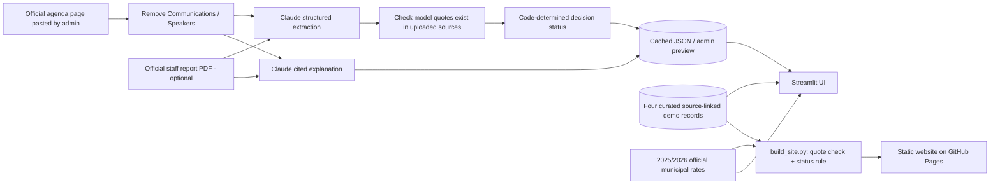

# CivicClear — City Decisions, Decoded

**CIVIC Hack 2026 prototype · City of Toronto · Source-linked decision explainers**

**Live website: https://zxding2007.github.io/civicclear-2026/** — opens in any browser, no sign-in. Published from `site/` by GitHub Actions on every push to `main`.

CivicClear gives residents a plain-language summary of **what was proposed**, **which decision-making body actually acted**, **which wards appear in the record**, **what is and is not known about participation**, and **the text supporting each claim**.

> **Project state (Nov 13, 2026):** The static website above is the main demo. It shows four curated Toronto agenda items and never calls an AI model. The four cards were drafted with ChatGPT from official agenda excerpts and pass the automated quote and status checks; the team's human sign-off is **still pending** and each card says so. The repository also holds an earlier Streamlit version (https://civicclear-2026.onrender.com/, Render Free Plan, slow to wake) and an optional, password-gated Claude API analyser for new items. That analyser has only been exercised with a fake client: **no real API call has been made**.

## Why this exists

A statement like “received for information” may sound like approval to a resident. Conversely, a committee's amended decision may not be final Council approval. CivicClear uses a **three-stage decision timeline** instead of collapsing all official language into a yes/no verdict.

**Primary users:** Toronto residents; potential institutional users include council offices, clerks, public engagement and communications teams.

## Features

- **Council Decoder:** Staff recommendation → committee action → City Council decision, with verbatim evidence.
- **Ward filter:** Match an agenda item's listed ward(s) to a user-selected ward; citywide items apply to all.
- **Claim-level source panels and stakeholder impacts:** Two core planning cases distinguish official priorities from possible consequences and questions for residents, businesses and community organizations. No quantified effects are inferred.
- **Have Your Say:** Never infer a comment deadline from a meeting date. For PH29.2, a *separate current City consultation portal* confirms an interactive feedback map through **November 30, 2026**; the app auto-stops advertising it as open afterward. Other items do not claim unverified open windows.
- **Before & After:** A residential **municipal** property tax estimate comparing 2025 and 2026 at a *constant* MPAC assessed value. Education tax is excluded.
- **Evidence and uncertainty:** Expand the original quote and source link for every example explanation, and see important unknowns.
- **Optional admin analysis (Streamlit version only, untested live):** With an Anthropic key and admin password, paste official Toronto agenda text and an optional staff-report PDF for two separate AI passes: structured extraction and cited explanation.

### Four example items

| Toronto agenda item | Official stage | What it illustrates |
| --- | --- | --- |
| [2026.DM41.4](https://secure.toronto.ca/council/agenda-item.do?item=2026.DM41.4) | Council received for information | A motion **was not approved** merely by being received |
| [2026.PH29.2](https://secure.toronto.ca/council/agenda-item.do?item=2026.PH29.2) | Committee adopted with amendments | Official [project feedback map](https://haveyoursay.toronto.ca/LJOV-Planning-Framework-CHRA) is advertised open through Nov. 30, 2026; still no final Council framework adoption |
| [2026.PH29.1](https://secure.toronto.ca/council/agenda-item.do?item=2026.PH29.1) | Council adopted without amendments | Separate staff, committee and Council stages |
| [2026.CC38.1](https://secure.toronto.ca/council/agenda-item.do?item=2026.CC38.1) | Council adopted with amendments | Source-based municipal tax calculation |

The example `item_page.txt` files intentionally contain **selected, non-personal excerpts**, not full scraped pages. The source links lead to the entire official record. A complete source excerpt and any uploaded staff report should be manually inspected by the team before publishing any automatically generated card.

## Run locally

Use Python 3.12:

```bash
python -m venv .venv
# macOS/Linux:
source .venv/bin/activate
# Windows PowerShell:
# .venv\Scripts\Activate.ps1
python -m pip install -r requirements.txt
streamlit run app.py
```

The four preloaded items and tax calculator work **without any API key**.

Optional, local admin analysis:

```bash
cp .env.example .env
# Fill in the .env values with your own secrets; never commit .env
# On macOS/Linux: set -a; source .env; set +a
streamlit run app.py
```

For Windows PowerShell, set the three environment variables in that shell, or use Streamlit `.streamlit/secrets.toml` locally. Streamlit Community Cloud secrets are entered in the app's Settings / Secrets dialog; **do not commit secrets**. No external LLM call occurs until an administrator opens and uses the protected page.

To generate a cache for a new item by CLI: prepare `data/items/<ID>/item_page.txt`, `meta.json`, and optionally `report.pdf`; run `python build_cache.py --item <ID>` with `ANTHROPIC_API_KEY` set. `--force` is required to replace existing curated cards, and generated output is labelled **AI unreviewed**.

## Test

```bash
python -m pytest -q
python -m compileall -q app.py pipeline calculator.py build_cache.py
```

Local result on 2026-11-13: **30 passed**, using bundled public-source excerpts. These tests do **not** imply full PDFs have been parsed or paid API calls have been verified.

## Architecture and data flow



Key design choices: (1) structured JSON and document citations require separate API requests; (2) verified stages drive decision status in code, not model sentiment; (3) unknown participation stays unknown; (4) defaults use prebuilt files so an unprotected public page never incurs API cost; (5) the static website is built by `build_site.py`, which reruns the quote check and status rule and stops the publish if a computed status differs from the stored or golden one. The upper half of the diagram (Claude extraction and explanation) is the optional path for new items and has not been run against the real API. See [`docs/uml.md`](docs/uml.md).

## Accuracy checks and limitations

| Control | Implementation / verification | Remaining work |
| --- | --- | --- |
| Structured data | `DecisionCard` Pydantic model | Try real paid API calls |
| Source check | Verbatim quote membership in provided text or extracted PDF text | Human comparison with original authoritative documents; normalized membership does **not** establish context |
| Stage rule | `overall_status`, council precedence | Expand coverage for unusual Toronto procedural outcomes |
| Golden examples | Four `golden.json` expected outcomes, 30 automated tests (including fake-SDK contract checks) | Independent human sign-off, cross-check full report PDFs |
| Privacy | Removes `Communications` / `Speakers` text sections | Not a substitute for comprehensive personal-data review, access controls or municipal privacy assessment |
| Engagement | Absent verified current deadline → "not verified" | Manually verify current notices and participation windows |

**Important:** The demo's ward matching is based on a ward *listed in the official item*, not a geocoded impact assessment. The calculator compares municipal taxes at a constant assessed value; it does not predict an actual person's 2025–2026 bills. This is not legal or tax advice. Live model-generated summaries must be reviewed before public use.

## Who this may leave out

- **English only.** No translation, although many Toronto residents read another language first.
- **Online only.** People without a device or connection are not reached; the City's 311 line and the City Clerk's office remain the fallback.
- **Four items.** It is a worked example, not a feed of every agenda item, and it does not update itself.
- **Ward match, not address match.** A ward shows as relevant when the record names it. Renters, businesses or neighbours just across a ward boundary may be affected without being matched.
- **Tax calculator is for owners.** It needs an MPAC assessed value, so it says nothing to tenants about rent.
- **Accessibility is not audited.** The page has not been tested against WCAG 2.1 AA or with screen-reader users.

## Deployment

The static website in `site/` is published to GitHub Pages at https://zxding2007.github.io/civicclear-2026/ by `.github/workflows/pages.yml` (tests and `build_site.py` run first; a status mismatch stops the publish). It needs no server or API key; `site/index.html` also opens directly from disk.

This repository is already public at https://github.com/zxding2007/civicclear-2026 and the Streamlit version is deployed as a Python Streamlit service on Render Free Plan at https://civicclear-2026.onrender.com/. In [Streamlit Community Cloud](https://docs.streamlit.io/deploy/streamlit-community-cloud), create an app with `app.py` as the entrypoint and Python 3.12. Configure Secrets only if you want to enable admin analysis. Check both desktop and mobile views and wake the free instance before judging. A public deployed URL is optional according to Devpost, but a repository, 2–3 minute demo and one-page report are required.

## Deliverables

- [Municipal Readiness Report (PDF)](docs/readiness_report.pdf)
- [Municipal Readiness Report (editable Markdown)](docs/readiness_report.md)
- [UML diagrams](docs/uml.md)
- [AI disclosure](docs/ai_usage.md)
- [Live AI smoke test status (no real API key)](docs/live_ai_smoke_test.md)
- [Video recording and Devpost final checklist](docs/recording_and_submission_steps.md)
- [Data and library credits](docs/sources.md)
- [Checkpoint messages and Devpost draft](docs/checkpoints_and_devpost.md)
- [Demo video script](docs/demo_video_script.md)
- [Accuracy / verification matrix](docs/accuracy_matrix.md)
- [Independent official-source cross-check](docs/official_source_audit_2026-11-12.md)
- [Team sprint roles](docs/team_roles.md)
- [Operator / manual validation checklist](docs/operator_checklist.md)

## Credits and licence

Open-source Python libraries: Streamlit, Pydantic, Anthropic SDK, pypdf, python-dotenv and pytest. Records and tax rates originate from official City of Toronto pages (consult current municipal usage terms). The static website uses the taste-skill frontend kit (`site/assets/`: layout, motion, diagram and icon files) and was built with Claude Code. AI assistance in code and writing (ChatGPT and Claude) is declared in [`docs/ai_usage.md`](docs/ai_usage.md). Prototype source code is supplied under the MIT licence; third-party content retains its own terms.
