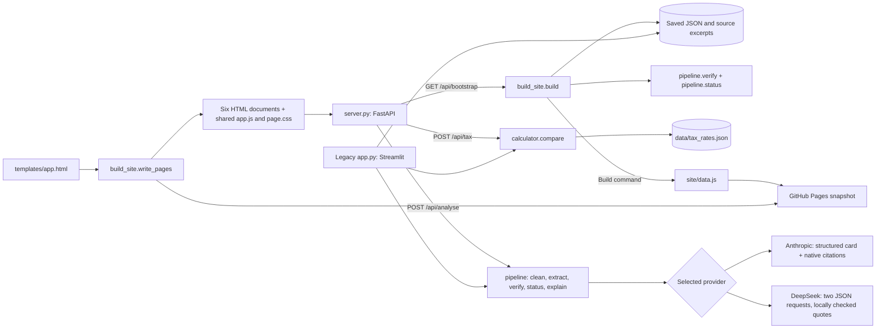
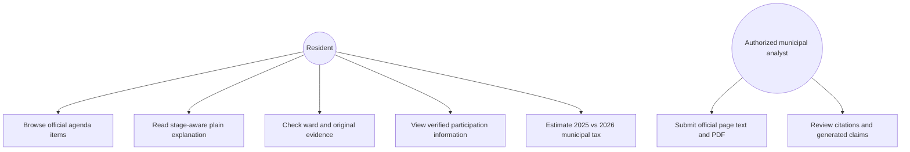
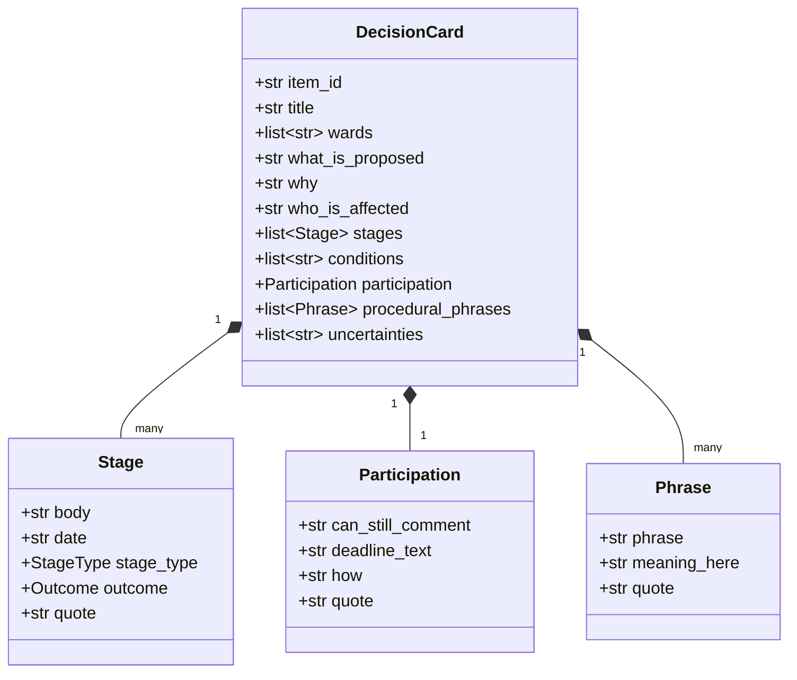
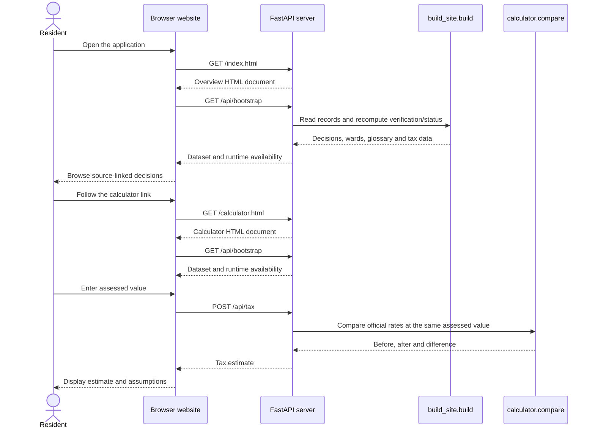

# CivicClear system design / UML

The preferred local application runs `server.py` with Uvicorn. FastAPI serves six separate HTML documents and its API from the same address. Ordinary links load a new document for navigation; there is no hash router. `app.py` remains a separate legacy Streamlit interface. The Pages build packages those documents and the data snapshot without the Python API. This latest local revision is being prepared for review; it has not yet been pushed or deployed.

## Application components



`GET /api/health` returns `{"status":"ok"}`. The bootstrap response includes `runtime.mode = "connected"` and whether analysis credentials are configured; it never includes the credentials. Tax requests contain an assessed value. Analysis accepts a password, official agenda URL, pasted text and an optional PDF, and returns an item in the same shape as the bundled decisions. New analysis results are not written to the data directory.

The documents are `index.html` (overview), `decisions.html`, `decision.html?id=...`, `calculator.html`, `sources.html` and `analyse.html`. `templates/app.html` owns their shared shell. `python build_site.py` verifies and writes the data bundle, then calls `write_pages(OUT.parent)` to generate each document. Shared JavaScript provides interactions within the current page; the browser handles page-to-page navigation.

When the Python API is unavailable, the browser uses `site/data.js` and computes tax from its saved rates. New-record analysis stays unavailable. `data/tax_rates.json` preserves both agenda links and the enacted [2025 levy bylaw](https://www.toronto.ca/legdocs/bylaws/2025/law0105.pdf#page=6) and [2026 levy bylaw](https://www.toronto.ca/legdocs/bylaws/2026/law0133.pdf#page=6) supporting the municipal rates; education tax is excluded.

## Use-case diagram



## Class diagram



## Connected public view



## Optional analysis sequence

This path has been tested with mocked AI responses only; successful live provider requests have not been established.

```mermaid
sequenceDiagram
    actor A as Analyst
    participant UI as Browser website
    participant API as FastAPI server
    participant R as Redaction
    participant AI as Selected provider: Claude or DeepSeek
    participant V as Source verification
    participant S as Status rules
    A->>UI: Enter password, official URL, agenda text and optional PDF
    UI->>API: POST /api/analyse (multipart)
    API->>API: Check credentials, exact item URL and upload
    API->>R: Remove Communications and Speakers sections
    R-->>API: Cleaned text
    Note over API,AI: DeepSeek receives text, including locally extracted readable PDF text
    API->>AI: Structured extraction (Claude parse or DeepSeek JSON)
    AI-->>API: Pydantic DecisionCard
    API->>API: Require item ID to match submitted URL
    API->>V: Verify stage quotes against submitted sources
    V-->>API: Verified stage flags
    API->>S: Compute overall decision status
    S-->>API: Decision-status label
    API->>AI: Separate explanation request
    AI-->>API: Claude citations or DeepSeek JSON quotation references
    API->>V: Verify explanation quotes
    V-->>API: Explanation citation flags
    API-->>UI: Item marked ai_unreviewed, human review pending
    UI-->>A: Preview marked UNREVIEWED
    Note over A,API: No result is saved or published; human review remains required
```

## Design rationale

1. **Two API calls:** Both providers separate structured extraction from explanation. Claude keeps its structured-output and native citation requests. DeepSeek returns JSON for both passes; Pydantic validates the card and local source checks validate the quoted wording. Model-provided references are not native Anthropic citations.
2. **Code-determined status:** A quote must match a source before its stage can drive a status label. Council actions take precedence over earlier committee actions.
3. **Saved examples in both modes:** The connected app reads four curated cases through its Python API. GitHub Pages uses the same records bundled into `site/data.js`. Opening either version makes no AI request and incurs no AI charge.
4. **Privacy-aware ingestion:** Drop named-correspondent and speaker sections before external API transmission. In a production system this must be supplemented by manual review and a privacy impact assessment.
5. **Cautious uncertainty:** The absence of a confirmed participation deadline is shown as such, not guessed from a calendar date.
6. **One shared backend:** The connected website reuses the existing record builder, calculator and analysis pipeline. The browser receives results over HTTP while API credentials remain on the server. The static snapshot cannot run new-item analysis.
7. **Separate documents, shared source:** Six generated HTML pages use ordinary navigation while one template keeps their layout consistent. Shared JavaScript does not replace document navigation with a client-side router.


## Provider selection

Configure `CIVICCLEAR_PROVIDER=deepseek` plus `DEEPSEEK_API_KEY`, or `CIVICCLEAR_PROVIDER=anthropic` plus `ANTHROPIC_API_KEY`. Web analysis also requires `CIVICCLEAR_ANALYST_PASSWORD`. When the provider is unset, DeepSeek is selected only if its key is present and the Anthropic key is absent; otherwise Anthropic is selected. Defaults are `deepseek-flash` and the existing `claude-opus-5-5`; `CIVICCLEAR_MODEL` can override them. Remove or replace a stale model override when switching provider. Keys remain server-side for the web app, CLI and legacy Streamlit interface.

The DeepSeek path extracts PDF text locally and rejects files without readable text; it does not add OCR or native PDF input. Source text and extracted report text go to the chosen provider only on explicit analysis. The Claude path continues to use its existing PDF/text document inputs and citation API. The shared verification and deterministic status rules remain in place for both paths.

## Running and hosting

Create the environment with `python3.12 -m venv .venv` on macOS/Linux, or `py -3.12 -m venv .venv` on Windows, then activate it and install `requirements.txt`. Run `python build_site.py` to generate the pages and data, then `python -m uvicorn server:app --reload` and open `http://localhost:8000`. The server loads optional analysis settings from `.env`; the earlier Streamlit UI still runs with `streamlit run app.py` using its own environment or Streamlit secrets.

`render.yaml` describes the connected Python service with HTTP health checks at `/api/health`. Using it for the existing Render deployment requires changing that service's start command to `uvicorn server:app --host 0.0.0.0 --port $PORT`. The configuration is included in the repository, but that deployment change has not been performed.

## Local validation status

The earlier multi-page revision passed **57 Python tests** on November 13, 2026. Provider support uses mocked tests; rerun the full suite for the current revision and record its result separately. Browser checks covered desktop and 375-pixel mobile layouts, page navigation, keyboard interaction and invalid calculator inputs. These checks do not constitute a formal accessibility audit. AI requests were mocked; neither provider has received a real paid inference request, and no new production deployment was tested. Independent human review of the curated decisions remains pending.
