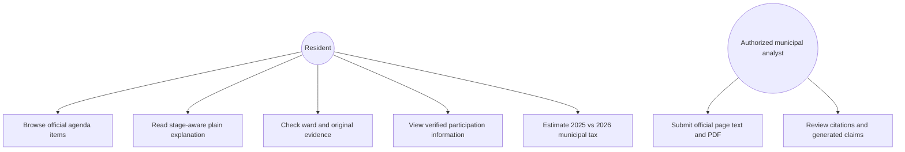
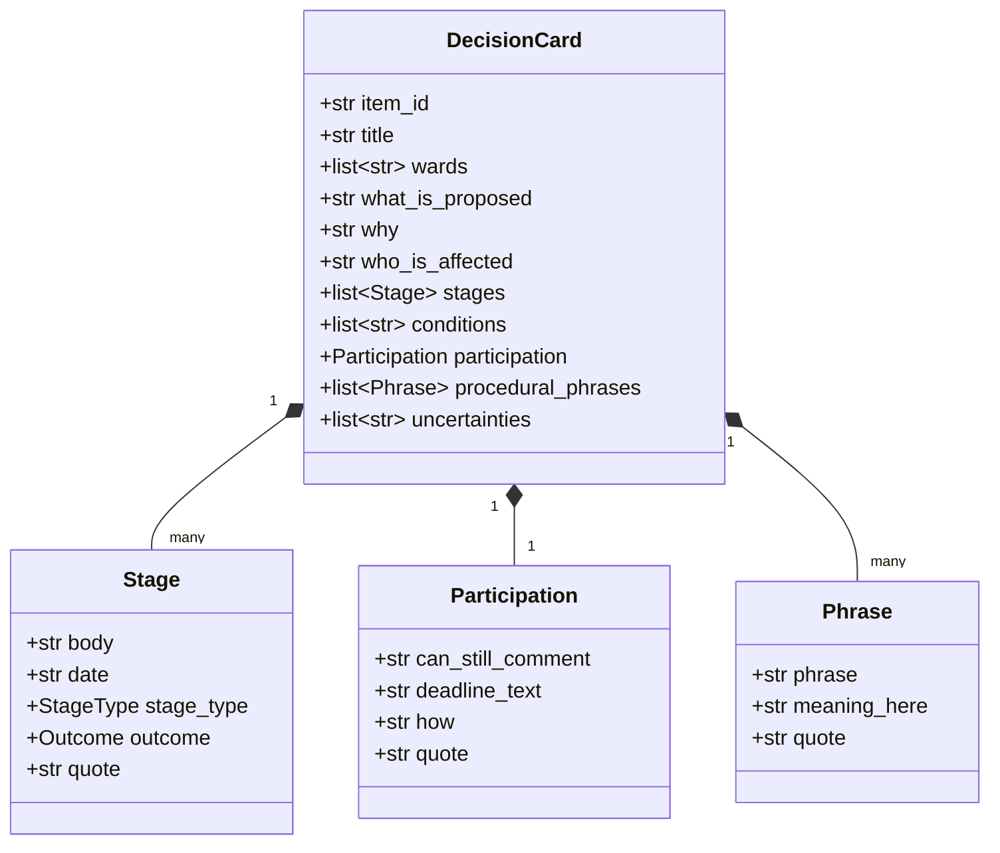
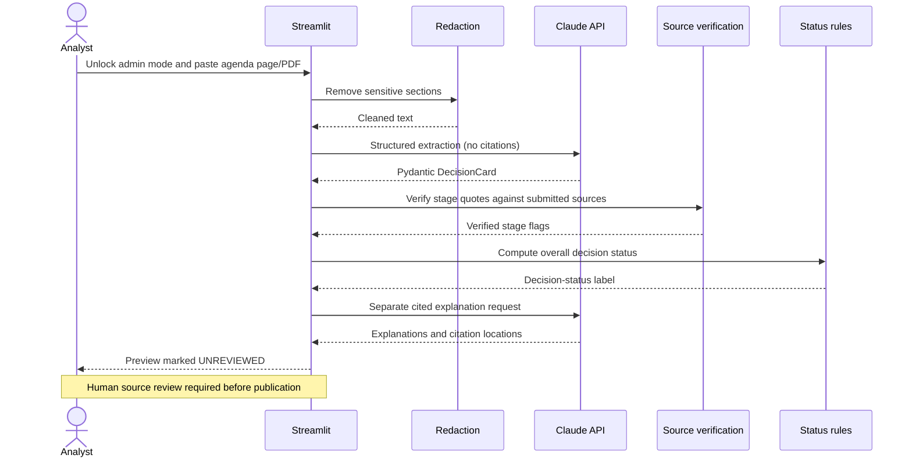

# CivicClear system design / UML

## Use-case diagram

## Class diagram

## Sequence diagram

## Design rationale

1. **Two API calls:** Structured JSON output and interleaved citations cannot be requested in the same Claude API response, so the system separates format validation and cited narrative.
2. **Code-determined status:** A quote must match a source before its stage can drive a status label. Council actions take precedence over earlier committee actions.
3. **Offline-safe demo:** The public view has four bundled curated cases; there are no background requests or API charges just for opening the website.
4. **Privacy-aware ingestion:** Drop named-correspondent and speaker sections before external API transmission. In a production system this must be supplemented by manual review and a privacy impact assessment.
5. **Cautious uncertainty:** The absence of a confirmed participation deadline is shown as such, not guessed from a calendar date.
